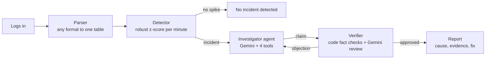

# Incident Triage Agents

**Two AI agents that read a system's logs and find out *why* it broke, with evidence.**

When a service fails, the services that depend on it fail too, and their errors are often
louder than the real cause. This project detects incidents in log files and uses an
**Investigator** agent to find the root cause and a **Verifier** agent to check it, before
producing a report with the cause, the evidence from the logs, and a suggested fix.


---

## Features

- **Any log in:** simulate an incident, describe one in plain English, upload a file, or paste lines.
- **Reads real log formats:** JSON lines, CSV, plain text, syslog, Apache, HDFS, Hadoop, Spark,
  Zookeeper and BGL. Tested on 8 real files from the public [Loghub](https://github.com/logpai/loghub) collection.
- **Statistical detection:** finds abnormal error and latency spikes per service, per minute.
  Healthy logs give *"No incident detected"*, and no AI is called.
- **Two collaborating agents:** the Investigator chooses its own tools; the Verifier gathers
  its own evidence and can send the answer back for another round.
- **Fact-checked output:** every service and time the AI states is checked against the logs in code.
- **Measured accuracy:** a benchmark scores the agents against simple rules on the same incidents.
- **Never crashes on bad input:** clear messages for empty, binary, oversized or unreadable files.
- **Works offline:** if Gemini is unavailable, it falls back to rule-based reasoning and says so.

---

## How it works



| Step | What happens | AI used? |
|---|---|---|
| **Parser** (`core/parser.py`) | Converts any supported format into one table: time, level, service, message, latency | Only to help with unknown formats |
| **Detector** (`core/detector.py`) | Compares every minute with the previous 15 minutes and flags sudden error or latency jumps | No |
| **Investigator** (`agents/triage.py`) | Loops: think, call a tool, read the result, until it names the root service with evidence | Yes |
| **Verifier** (`agents/triage.py`) | Code checks that the service exists, was abnormal, didn't fail after another, and that every stated time is real; then Gemini reviews with its own tool calls | Partly |
| **Report** | Built by code from validated fields, so the AI can't add unchecked claims | No |

**Agent tools** (`core/tools.py`), all read-only:

| Tool | Returns |
|---|---|
| `service_timeline` | When each service's error burst began, and its most common message |
| `search_logs` | Matching log lines (at most 25) |
| `get_metrics` | Errors and latency, minute by minute |
| `search_runbook` | Known problems and fixes from `data/runbook.md` |

The agent loop is plain Python (a ReAct-style *reason, act, observe* loop, about 40 lines), not a
framework, so every step is visible in the app's **Agent trace** and covered by tests.

---

## Quick start

**Requirements:** Python 3.11 or newer, and a free Gemini API key from [AI Studio](https://aistudio.google.com).
Without a key the app still runs, in offline mode.

**Windows (PowerShell):**
```powershell
python -m venv .venv
.venv\Scripts\Activate.ps1
pip install -r requirements.txt
```

**macOS / Linux:**
```bash
python3 -m venv .venv
source .venv/bin/activate
pip install -r requirements.txt
```

**Add your API key:** create `.streamlit/secrets.toml` (see `.streamlit/secrets.toml.example`):
```toml
GEMINI_API_KEY = "your-key-here"
```
This file is in `.gitignore` and must never be committed.

**Check which Gemini models your key can use:**
```bash
python check_models.py
```
Put a model that prints `OK` first in `GEMINI_MODELS` in `config.py`.

**Run:**
```bash
streamlit run app.py
```

**Run the tests** (no API key needed; they use a scripted stand-in for Gemini):
```bash
python -m pytest -q
```

---

## Using the app

| Input mode | What you give | Accuracy score? |
|---|---|---|
| Simulate incidents | Incident types, start time, duration, easy or hard | Yes |
| Describe a scenario | *"payment service runs out of memory at 11 am"* | Yes |
| Upload a log file | `.log`, `.txt`, `.jsonl`, `.csv`, up to 5 MB | No answer key exists |
| Paste log lines | At least 20 lines | No answer key exists |

**Simulated incidents:** db timeout, memory leak, auth failure, disk full, cache down, and
auth slowdown (a deliberately misleading case). **Hard mode** makes the affected services fail in
the same minute as the cause and log more errors than it, so timing alone can't identify the cause.

**Tabs:** *Analyse* (chart, report, agent trace) · *Evaluation* (score and benchmark) ·
*Ask about the results* (questions answered from the evidence).

**Sidebar:** Gemini on/off, a live connection check, and *Replay last good run* as a demo backup.

---

## Results

| Test | Result |
|---|---|
| Hard-mode benchmark, `gemini-3.5-flash-lite` | Root cause correct in **7 of 7** incidents; simple timing rules got **0 of the same 7** |
| Healthy simulated logs (100 runs) | **0** false alarms |
| Real Loghub logs | All 8 files read with correct dates, times and service names |
| Real Hadoop log | Diagnosed a **network** failure reaching the resource manager; all evidence lines verified in the file |

These numbers come from a small sample on our own simulator, so they are reported as counts,
not as an accuracy percentage. Run the benchmark tab to reproduce them.

## Known limitations

- **Latency-only causes are missed.** In the *auth slowdown* case the cause shows up only as
  slowness, not errors, and the agents blamed the wrong service. They also missed early warnings
  in the real Hadoop log.
- **Root cause = a service in the logs.** If the real cause is outside the logs (for example a
  network link), the report names the service where the failure appears and explains the
  external cause in the summary.
- **No answer key for real logs.** Uploaded logs can't be scored automatically; judge the report by its evidence.
- **Free API limits.** Each incident costs about 4-10 Gemini calls; many incidents in a row can hit
  the rate limit, after which the app falls back to offline reasoning.
- **Synthetic evaluation.** The simulator was written by the same team as the agents.

---

## Project structure

```
app.py               Streamlit web app
config.py            every limit, threshold and model name in one place
check_models.py      lists which Gemini models your key can use right now
core/
  generator.py       simulated logs with hidden incidents and an answer key
  parser.py          any input to one table, or a clear error
  detector.py        per-minute anomaly detection
  tools.py           read-only tools the agents call
  llm.py             Gemini wrapper: retries, model fallback, offline switch
  pipeline.py        runs everything; scores results against the answer key
agents/
  triage.py          Investigator, Verifier, fact checks, report
  assist.py          scenario reader, log-format helper, Q&A
data/runbook.md      known incident patterns and fixes
tests/               102 automated tests
```

---

## Deployment (Streamlit Community Cloud)

1. Push this repository to GitHub (`secrets.toml` stays out via `.gitignore`).
2. On [share.streamlit.io](https://share.streamlit.io), create an app from the repo with main file `app.py`.
3. In the app's **Settings → Secrets**, add `GEMINI_API_KEY = "your-key"`.
4. Open the app URL and click **Re-check Gemini** in the sidebar.

---

## Team

| Member | Area |
|---|---|
| Name 1 | Log generator and parser |
| Name 2 | Detection and evaluation |
| Name 3 | Agents, tools and Gemini integration |
| Name 4 | Web app, scenarios, deployment |

## Credits

- Real log samples: **Loghub**, a collection of system log datasets for AI-driven log analytics
  ([github.com/logpai/loghub](https://github.com/logpai/loghub)).
- Built with Python, pandas, NumPy, Streamlit, Altair and the Google Gen AI SDK.
